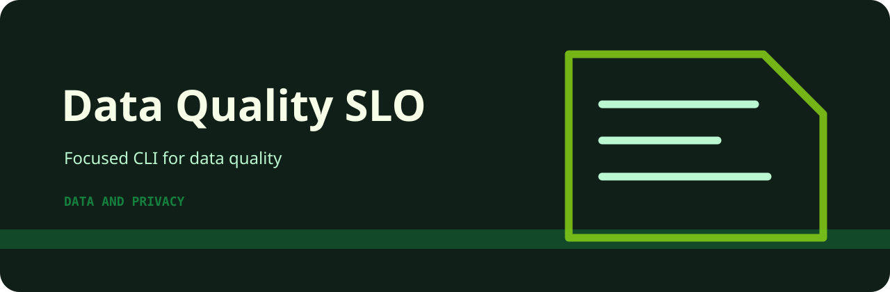

# Data Quality Slo



Check data quality SLO manifests for freshness, completeness, and owner fields.

`Python`

## Start here

```bash
git clone https://github.com/mertefekurt/data-quality-slo.git
cd data-quality-slo
python -m pip install -e ".[dev]"
data-quality-slo examples/sample.txt
```

## Repository

[Open the source on GitHub →](https://github.com/mertefekurt/data-quality-slo)

[MIT License](LICENSE)
